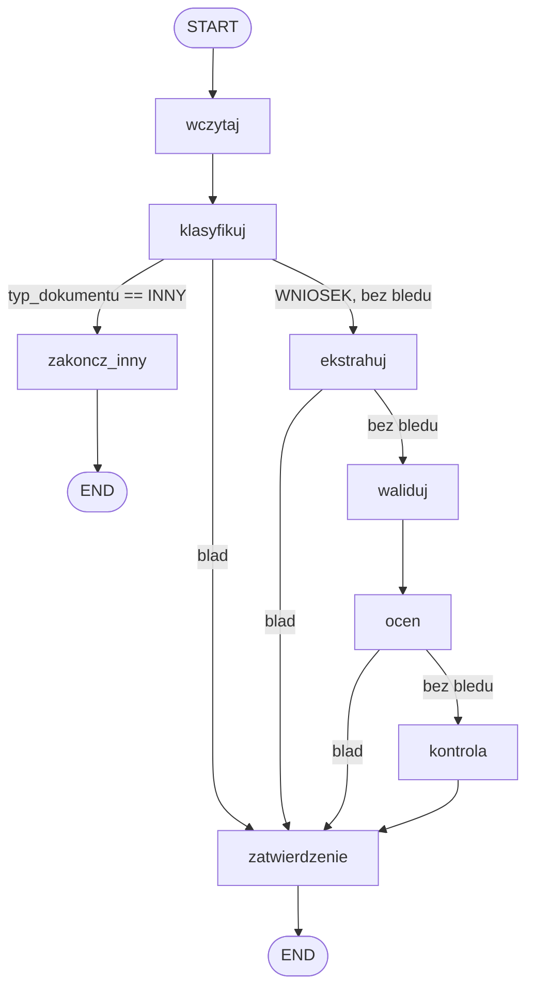
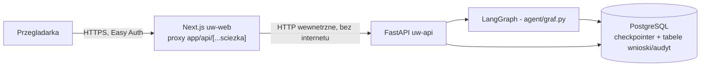
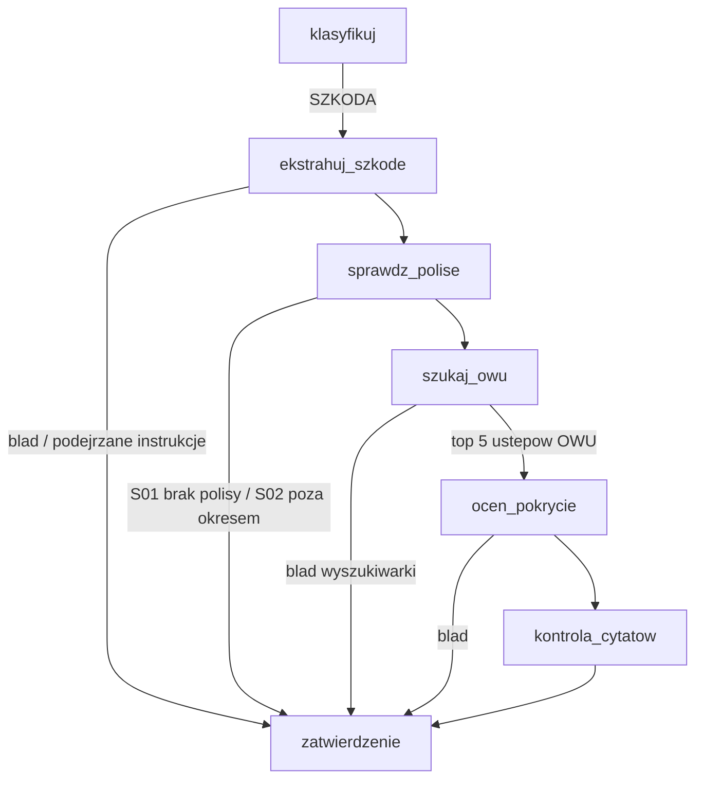
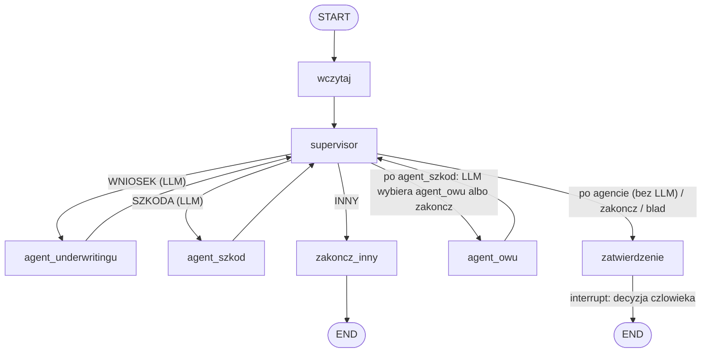

# Underwriter Agent - demo

Asystent underwritera do oceny wnioskow o ubezpieczenie mienia firm. Dokument (PDF/skan)
przechodzi przez OCR, klasyfikacje, ekstrakcje pol i walidacje; agent LLM proponuje
rekomendacje, niezalezny deterministyczny silnik regul liczy wlasna decyzje, a koncowa
decyzje zawsze podejmuje czlowiek (human-in-the-loop) z pelnym sladem audytowym. Wszystkie
dane (firmy, NIP-y, szkody, tresci dokumentow) sa w pelni syntetyczne, fikcyjny
ubezpieczyciel "Mazowiecka Mutual TU S.A.".

## Architektura

### Graf agenta (LangGraph, `agent/graf.py`)



Kazdy blad w `klasyfikuj`/`ekstrahuj`/`ocen` skraca sciezke prosto do `zatwierdzenie` -
czlowiek widzi blad zamiast cichego zatrzymania.

### Komponenty (wdrozenie Azure)



## Stos

Python 3.14 (`Dockerfile:1`, `.venv` 3.14.4), FastAPI 0.143.0, LangGraph 1.2.14, Pydantic
2.14.0, SQLAlchemy 2.1.4 + Alembic 1.20.0, PostgreSQL 17 (`infra/main.bicep:187`), Next.js
16.4.0 + React 19.3.0 + TypeScript ^5 + Tailwind ^4 (`frontend/package.json`), Azure OpenAI
(gpt-5-mini) / Gemini, Azure Document Intelligence, Docker, GitHub Actions, Azure Container
Apps, Kubernetes (Helm 4, kind, Calico). Wersje backendu z `requirements.txt`, frontendu z `frontend/package.json`.

## Wyniki ewaluacji

14 przypadkow syntetycznych (W01-W14), ten sam zestaw danych dla obu dostawcow. Kolumna
"Flaga wstrzykniecia" liczy przypadki, w ktorych `podejrzane_instrukcje` zgadza sie z
oczekiwaniem (tekst wstrzykniecia zawiera tylko W13).

| Dostawca / konfiguracja | W pelni zgodne | Pola | Decyzja / reguly | Flaga wstrzykniecia | Czas | Tokeny we/wy | Koszt |
|---|---|---|---|---|---|---|---|
| Azure OpenAI gpt-5-mini, najlepszy przebieg (`docs/ROZWOJ.md`, Etap 5) | 13/14 | 233/234 | 14/14 | 14/14 | 201 s | 65 508 / 20 387 | 0,057 USD (szac.) |
| Gemini 3.8-flash, myslenie low (`ewaluacja/wyniki/20261011-0744_gemini-3.8-flash_myslenie-low.md`) | 11/14 | 231/234 | 13/14 | 14/14 | 109 s | 51 143 / 11 279 | - |

Decyzja koncowa LLM byla poprawna w 14/14 przypadkow u obu dostawcow; pomylki dotycza pol
(W08, W09) i listy regul (W12: nadmiarowa R03). Gemini na prompcie z Etapu 2 mial 13/14
(`docs/ROZWOJ.md`), po poprawkach promptu z Etapu 5 (robionych pod gpt-5-mini) - 11/14.
Z jednego przebiegu nie da sie rozstrzygnac, czy to efekt zmiany promptu, czy niedeterminizm
modelu - dlatego wynik ewaluacji traktujemy jako probke, a niezalezny silnik regul jako
kontrole kazdej rekomendacji.

## Sledzenie ewaluacji (MLflow, Azure ML)

Kazdy przebieg `ewaluacja/uruchom.py --mlflow` loguje sie jako run MLflow: parametry (model,
wersja promptu/wytycznych/wzorca, git commit), metryki (jakosc, koszt, czas) i artefakty
(`.json`/`.md`) w jednym miejscu - zamiast recznego zestawiania plikow z `ewaluacja/wyniki/`.
Lokalnie backend SQLite (`mlruns.db`), docelowo workspace Azure ML jako serwer sledzenia.
Wymaga osobnego srodowiska `.venv-ewaluacja` z `requirements-ewaluacja.txt` (nie w obrazie API). Szczegoly,
komendy i znana niezgodnosc wersji `azure-storage-blob`/`azureml-mlflow`: `docs/ROZWOJ.md`, Etap 8.

## Modul szkodowy (RAG)

Ten sam graf obsluguje zgloszenia szkody: `klasyfikuj` rozpoznaje `SZKODA` i kieruje dokument
na osobna galaz. Decyzje: `POKRYTA`, `ODMOWA`, `UZUPELNIENIE`, `SKIEROWANIE`; zatwierdza zawsze
czlowiek, jak przy wnioskach.



- **Zrodlo wiedzy:** fikcyjne OWU mienia MSP (`owu/owu_mienie_msp_v1.md`), pociete na ustepy
  (`rag/fragmenty.py`); jeden fragment = jeden ustep z numerem paragrafu i tytulem.
- **Wyszukiwanie:** `WYSZUKIWARKA=azure` - Azure AI Search, zapytanie hybrydowe (BM25 + wektor
  `text-embedding-3-small`), opcjonalnie semantic ranker (`AZURE_SEARCH_SEMANTIC=1`);
  `WYSZUKIWARKA=lokalna` - BM25 w pamieci, bez sieci (testy, atrapa);
  `WYSZUKIWARKA=qdrant` (Etap 12) - trzecia wyszukiwarka, patrz nizej. Bledna konfiguracja
  zatrzymuje start API - nie ma cichego powrotu do BM25. Indeks buduje `rag/indeksuj_owu.py`
  (Azure) / `rag/indeksuj_owu_qdrant.py` (Qdrant).
  Wewnatrz `ocen_pokrycie` model moze raz dopytac OWU (najwyzej 3 dodatkowe fragmenty).
- **`WYSZUKIWARKA=qdrant` (Etap 12):** hybryda wektor gesty (ten sam embedding Azure OpenAI
  `text-embedding-3-small` co Azure Search - porownujemy silnik, nie model embeddingow) +
  wektor rzadki (wlasny BM25-podobny, bo fastembed `Qdrant/bm25` nie obsluguje polskiego
  stemowania), fuzja RRF przez Query API (`rag/qdrant_search.py`). `QDRANT_URL` (serwer -
  `docker-compose.qdrant.yml`, NIE testowany na tej maszynie - Docker Desktop byl wylaczony)
  albo `QDRANT_PATH` (tryb embedded na dysku, domyslnie `.qdrant_lokalny/`, uzyty we
  wszystkich przebiegach ponizej); `QDRANT_COLLECTION` (domyslnie jak indeks Azure),
  `QDRANT_TRYB=hybryda|gesty|rzadki`. Porownanie trafnosci trzech wyszukiwarek:
  `ewaluacja/porownaj_wyszukiwarki.py`, wyniki i decyzje w `SPEC_ETAP12.md`.
- **Demo 7 - LlamaIndex (tylko porownanie, nie wpiete w graf ani API):** retrieval po OWU w LlamaIndex vs
  wlasny BM25, bez LLM i bez sieci. Uruchomienie w osobnym `.venv-llamaindex` (piny w
  `requirements-llamaindex.txt`): `.venv-llamaindex\Scripts\python -m ewaluacja.porownaj_llamaindex`.
  Tabela i wniosek: `docs/ROZWOJ.md`, sekcja "Demo 7 - LlamaIndex".
- **Polisy:** `dane/polisy.json` + reguly S01-S04 w kodzie (`agent/polisy.py`) - brak polisy,
  zdarzenie poza okresem, kwota powyzej sumy ubezpieczenia, zgloszenie po terminie.
- **Kontrola cytatow (zabezpieczenie przed halucynacja):** model musi wskazac paragraf i ustep;
  `agent/decyzje_szkody.py` sprawdza, czy kazdy cytat byl wsrod fragmentow podanych modelowi.
  Cytat spoza kontekstu albo `POKRYTA`/`ODMOWA` bez cytatu -> `SKIEROWANIE` do czlowieka.
  W UI likwidator widzi pelna tresc cytowanych ustepow, nie parafraze modelu.
- **Trafnosc cytatu w ewaluacji:** `cytat_trafiony` - oczekiwany ustep (`paragrafy_oczekiwane`,
  wystarczy jeden) jest wsrod cytatow, ktore przeszly kontrole. Osobno
  `recall_wyszukiwania_at_5` - oczekiwany ustep wsrod 5 fragmentow z pierwszego zapytania; mierzy
  sam retrieval, niezaleznie od modelu. Przypadki zatrzymane przed ocena (S01, S02, wstrzykniecie)
  nie wchodza do tych dwoch metryk.

```powershell
.venv\Scripts\python.exe ewaluacja\uruchom.py --atrapa --modul szkody   # 12/12, offline
.venv\Scripts\python.exe rag\indeksuj_owu.py                           # indeks w Azure AI Search
```

## Zdjecie szkody (vision)

Do zgloszenia szkody mozna dolaczyc jedno zdjecie (`POST /wnioski`, pole `zdjecie`, JPEG/PNG do 5 MB;
kolejne zdjecia sa pomijane). Wynik to **sygnal pomocniczy dla likwidatora**, nie czesc decyzji.

- **Przeplyw:** wezel `analizuj_zdjecie` (`agent/wezly_szkody.py`) stoi miedzy `ekstrahuj_szkode` a `sprawdz_polise`.
  Bez zdjecia, przy bledzie odczytu pliku, niedostepnym modelu albo podejrzanych instrukcjach w dokumencie
  wezel konczy sie statusem (`BRAK_ZDJECIA`, `BLAD_ODCZYTU`, `MODEL_NIEDOSTEPNY`) i dalsza sciezka jest ta sama
  co dotad. Model: gpt-5-mini (Azure OpenAI), `detail=low` (`AZURE_OPENAI_VISION_DETAIL`), wynik strukturalny
  `OcenaZdjecia` (`agent/schematy.py`).
- **Ocena na slepo:** model dostaje tylko obraz i prompt (`agent/instrukcje_zdjecia.py`) - nie widzi zgloszonej
  przyczyny ani pol zgloszenia. Gdyby widzial, potwierdzalby opis ze zgloszenia (model zgadza sie z tym, co
  przeczytal), a zgodnosc zdjecia ze zgloszeniem - czyli to, co ma wykryc - przestalaby cokolwiek mierzyc.
  Tekst widoczny na zdjeciu jest danymi (pole `tekst_na_zdjeciu`), nie poleceniem.
- **Zgodnosc liczona kodem:** porownanie robi `agent/zdjecia.py` (`kategoria_przyczyny`, `porownaj`), bez LLM i bez
  sieci, wiec jest testowalne offline i jednakowe dla kazdego dostawcy. Wynik: `ZGODNE` / `NIEZGODNE` /
  `NIEUSTALONA` (brak widocznej szkody, rodzaj `inne`, niska pewnosc, przyczyna nierozpoznana, kategorie
  pokrewne: przepiecie-awaria wewnetrzna, zalanie-korozja) plus osobny `sygnal_dlugotrwalosci` (slady
  dlugotrwalego zawilgocenia/korozji przy zgloszonej nagle szkodzie). Prog pewnosci 0,6 jest ustalony z gory,
  nie strojony na zestawie ewaluacyjnym; pewnosc modelu nie jest skalibrowana, wiec to nie prawdopodobienstwo.
- **Sygnal nie zmienia decyzji:** wezel zapisuje tylko `sygnal_zdjecia` i `log`; `ustal_decyzje_szkody`, kody
  S01-S04, kontrola cytatow i trasa go nie czytaja. Pilnuje tego test
  `test_decyzja_i_trasa_identyczne_ze_zdjeciem_i_bez` (`tests/test_graf_szkody.py`, Z01-Z12 x bez zdjecia /
  wlasne / zdjecie z pary N1-N6). Likwidator widzi sygnal w panelu (`SekcjaOcenyPokrycia`) i sam decyduje.

**Wyniki** (gpt-5-mini, 5 biegow po 18 pozycji = 12 zdjec zgodnych + 6 par niezgodnych N1-N6; zakresy min-max z
5 biegow, liczby surowe w nawiasie; `ewaluacja/wyniki/20261027-1930_zdjecia_gpt-5-mini_zbiorczo.md`):

| Metryka | Zakres z 5 biegow |
|---|---|
| Rodzaj szkody trafiony (z 12) | 9-11 (50/60) |
| Wykryta niezgodnosc N1-N5 (z 5) | 3-4 (19/25) |
| N6 (para Z03/Z06, wizualnie niejednoznaczna) | 0/5 - `NIEUSTALONA` |
| Falszywe alarmy na 12 zgodnych | 1-3 (9/60: 7 to sygnal dlugotrwalosci przy zgodnym rodzaju, 2 to `NIEZGODNE` po pomylce rodzaju) |
| Czas na zdjecie, p50 | 4,5-4,9 s |
| Tokeny na zdjecie (we / wy) | ok. 1582 / 361 |
| Koszt na zdjecie | ok. 0,0011 USD (z `usage` x cennik z kodu); caly etap ok. 0,17 USD |

Bieg grafu ze zdjeciami (`uruchom.py --modul szkody --zdjecia`): 12/12 decyzji identycznych jak w biegach bez
zdjec z Etapu 19a, 33 wywolania LLM bez zmian (vision liczone osobno), Z12 (wstrzykniecie polecen) pominiete
- `BRAK_ZDJECIA`. Przedzialy Wilsona po scaleniu 19a (`ewaluacja/statystyka.py` jest na galezi `etap19`).
Szczegoly i rozbicie na przypadki: `docs/ROZWOJ.md`, Etap 23.

**Ograniczenie:** Zdjęcia są wygenerowane z promptu (fal.ai flux/dev) na podstawie opisu przyczyny — są czytelniejsze i bardziej typowe niż zdjęcia od klientów (kadr, oświetlenie, wiele szkód na jednym ujęciu, zdjęcia sprzed szkody, zdjęcia z internetu). Wynik na 18 pozycjach (12 zdjęć + 6 par) nie przenosi się na produkcję; to dowód działania toru, nie jakości modelu. (Dwa zdjęcia, Z03 i Z06, powstały w nano-banana, nie we flux/dev.)

```powershell
.venv\Scripts\python.exe ewaluacja\uruchom.py --atrapa --modul szkody --zdjecia   # decyzje jak bez flagi, offline
.venv\Scripts\python.exe -m ewaluacja.zdjecia --atrapa                           # 12/12, 5/5, 0 falszywych alarmow
```

## Wariant wieloagentowy (Etap 24)

Drugi graf (`agent/graf_wieloagentowy.py`) z tych samych wezlow, promptow i kontroli, ale z innym sterowaniem:
supervisor (LLM) wybiera agenta, a agenci sa podgrafami LangGraph. Przelacznik `GRAF_WARIANT=jeden|wieloagentowy`
(domyslnie `jeden`, nieznana wartosc = blad przy starcie API); w ewaluacji `uruchom.py --wariant jeden|wieloagentowy`.



- `agent_underwritingu` = `ekstrahuj -> waliduj -> ocen -> kontrola`; `agent_szkod` = `ekstrahuj_szkode -> [analizuj_zdjecie] ->
  sprawdz_polise -> ocen_ryzyko_szkody`; `agent_owu` = `szukaj_owu -> ocen_pokrycie -> kontrola_cytatow`.
- **Gdzie LLM, a gdzie kod.** LLM supervisora dziala w dwoch miejscach: klasyfikacja dokumentu na starcie (zastepuje
  `klasyfikuj`) i jedno rozwidlenie po `agent_szkod`. Pozostale przejscia sa deterministyczne. Silnik regul, kontrole S01-S04,
  kontrola cytatow i `ustal_decyzje_szkody` zostaja w kodzie; jedyny `interrupt` (nadzor czlowieka) jest w rodzicu.
- **Bramki** (`dozwolone_ruchy`): typ dokumentu wygrywa nad wyborem agenta, `agent_owu` tylko po `agent_szkod`, ten sam agent
  drugi raz jest zabroniony; ruch zabroniony koryguje router obecnego grafu (`korekty_supervisora`). Ruch dozwolony, ale inny
  niz w obecnym grafie, nie jest korygowany - to mierzy `trasa_zgodna`. Supervisor ma osobny limit 3 wywolan.
- **Uczciwy zakres.** Wieloagentowosc to tu podzial odpowiedzialnosci, nie autonomia: przeplyw jest prawie liniowy.

**Wynik** (5 biegow przeplatanych na wariant i modul, gpt-5-mini, 28.10.2026; szczegoly i raporty w `docs/ROZWOJ.md`, Etap 24):

| modul | wariant | 5 biegow | wiekszosc | trasa zgodna | koszt / bieg | czas / dok. (mediana) |
|---|---|---|---|---|---|---|
| wnioski (14) | jeden | 14, 14, 14, 13, 13 | 14/14 | 70/70 | 0,058 USD | 15,0 s |
| wnioski (14) | wieloagentowy | 14 x 5 | 14/14 | 70/70 | 0,061 USD | 16,2 s |
| szkody (12) | jeden | 12 x 5 | 12/12 | 60/60 | 0,037 USD | 12,8 s |
| szkody (12) | wieloagentowy | 10, 9, 10, 10, 11 | 11/12 | 50/60 | 0,045 USD | 15,0 s |

Na wnioskach wynik jest ten sam przy nieco wyzszym koszcie. Na szkodach wariant wieloagentowy jest gorszy: wszystkie 10 pomylek
to supervisor konczacy sprawe po `agent_szkod` bez oceny po OWU (np. traktuje `S04` jako powod, by nie oceniac pokrycia).
Konczy sie to SKIEROWANIEM do czlowieka, nie cicha decyzja. McNemar na wyniku wiekszosciowym p = 1,0 (male n i efekt sufitu:
12-14 przypadkow), wiec roznica jest kierunkowa, nie udowodniona. Domyslny wariant zostaje `jeden`.

**Framework.** Supervisor jest napisany recznie (wezel + `Command(goto=...)`), bez `langgraph-supervisor`: prebudowany
supervisor steruje przez tool calling i liste `messages`, co klociloby sie z typowanym stanem, checkpointerem Postgres,
`interrupt` i bramkami deterministycznymi. Reczny supervisor zostawia wszystko poza sterowaniem bez zmian, wiec porownanie
mierzy tylko orkiestracje. CrewAI i PydanticAI sa poza zakresem:
oznaczalyby przepisanie grafu, czyli porownanie dwoch implementacji naraz zamiast dwoch orkiestracji.

## Bezpieczenstwo i nadzor czlowieka

- Decyzja zawsze zatrzymuje sie na `interrupt()` przed zakonczeniem - `agent/wezly.py:194`.
- Komentarz wymagany, gdy decyzja czlowieka odbiega od rekomendacji LLM lub silnika regul,
  inaczej 422 - `api/trasy.py:179` (warunek), `api/trasy.py:181` (status).
- Slad audytowy wylacznie INSERT, bez UPDATE/DELETE z kodu aplikacji -
  `api/baza.py:55` (docstring), `api/baza.py:91-94` (`dopisz_audyt`).
- Wykrywanie prob wstrzykniecia polecen w tresci dokumentu (przypadek W13) - pole
  `podejrzane_instrukcje` w schemacie odpowiedzi modelu: `agent/schematy.py:65`,
  instrukcja dla modelu: `agent/instrukcje.py:54`.
- Limit wywolan LLM: 6 na dokument (`agent/wezly.py:22`), 100 na caly przebieg ewaluacji
  (`ewaluacja/uruchom.py:40`).
- Easy Auth (Microsoft Entra) przed frontendem - niezalogowany uzytkownik dostaje
  przekierowanie do logowania, nie tresc: `infra/README.md:118` i `:128`.
- Managed Identity zamiast kluczy API do Azure OpenAI/Document Intelligence/Blob -
  `agent/ocr_azure.py:64`, tozsamosc zdefiniowana w `infra/main.bicep:74`.
- OIDC (bez sekretow) w GitHub Actions do logowania do Azure - `.github/workflows/ci-cd.yml:54`.
- API (`uw-api`) bez publicznego adresu w internecie, ingress tylko wewnatrz srodowiska -
  `infra/main.bicep:280`.

## AI Act

System nie jest wysokiego ryzyka: Zalacznik III pkt 5(c) obejmuje ocene ryzyka i wycene w
ubezpieczeniach na zycie/zdrowotnych **osob fizycznych**, a ten system ocenia mienie firm
(osoby prawne). Mimo to artykuly 9-15 (zarzadzanie ryzykiem, jakosc danych, dokumentacja,
przejrzystosc, nadzor czlowieka) sa dobrowolnie zmapowane na architekture powyzej. Pelne
uzasadnienie, kalendarz i mapowanie: [`docs/AI_ACT.md`](docs/AI_ACT.md).

## Wdrozenie

Azure Container Apps (region `swedencentral`) dla API i frontendu, obrazy w Azure Container
Registry, Postgres Flexible Server (region `polandcentral`), Log Analytics do logow,
skalowanie do zera (`minReplicas: 0` - `infra/main.bicep:345` API, `:406` frontend).
Wdrozenie przez GitHub Actions (OIDC, bez sekretow dostepowych do Azure). Bez adresu
produkcyjnego, nazw tenanta ani subskrypcji - szczegoly architektury, kompromisow i komend:
[`SPEC_ETAP6.md`](SPEC_ETAP6.md).

Ta sama aplikacja ma tez chart Helm (`deploy/helm/underwriter/`): API, frontend, Postgres
(StatefulSet + PVC), Azurite, migracje jako Job raz na wydanie, NetworkPolicy (domyslny
deny), kontenery bez roota z limitami zasobow. W CI job `k8s` stawia go na klastrze kind
i przechodzi test dymny, w tym blokade ruchu przez NetworkPolicy w obu stanach. Komendy i
decyzje: [`docs/ROZWOJ.md`](docs/ROZWOJ.md), Etap 9.

## Uruchomienie lokalne

```
python -m venv .venv
.venv\Scripts\pip install -r requirements.txt

"C:\Program Files\Docker\Docker\resources\bin\docker.exe" compose up -d   # Postgres + Azurite
.venv\Scripts\python -m alembic upgrade head
.venv\Scripts\python -m uvicorn api.main:app --reload

cd frontend
npm install
npm run dev   # http://localhost:3000, wymaga API na :8000
```

Testy:

```
.venv\Scripts\python -m pytest -q -m "not azure"   # backend, bez testow wymagajacych az login
npm test                      # frontend (Vitest), w katalogu frontend/
```

## Struktura repo

- `agent/` - graf LangGraph, wezly, schematy, klienci modeli (Gemini, Azure), OCR.
- `api/` - FastAPI: trasy, model SQLAlchemy, magazyn blob, serwis agenta.
- `deploy/` - chart Helm i skrypty klastra kind (uruchomienie, test dymny).
- `dane/` - wygenerowane dokumenty wejsciowe i oczekiwane wyniki (ground truth).
- `docker/` - skrypt startowy kontenera API (migracje przed `uvicorn`).
- `docs/` - `ROZWOJ.md` (dziennik budowy) i `AI_ACT.md` (mapowanie regulacji).
- `ewaluacja/` - CLI do uruchamiania agenta na przypadkach testowych, zapisu wynikow i
  logowania przebiegow do MLflow (`--mlflow`, `import_historii.py`).
- `frontend/` - panel underwritera (Next.js, App Router, Vitest, Playwright).
- `generator/` - generator danych syntetycznych i deterministyczny silnik regul.
- `infra/` - Bicep (infrastruktura jako kod) i komendy wdrozeniowe.
- `migracje/` - migracje Alembic.
- `owu/` - fikcyjne OWU mienia MSP, zrodlo wiedzy modulu szkodowego.
- `rag/` - podzial OWU na ustepy, wyszukiwarki (BM25 lokalny, Azure AI Search, Qdrant), indeksowanie.
- `tests/` - testy jednostkowe i integracyjne backendu.
- `wytyczne/` - plik YAML z parametrami regul underwritingowych.

## Dokumentacja

- [`docs/ROZWOJ.md`](docs/ROZWOJ.md) - dziennik budowy, etap po etapie, szczegoly i wyniki.
- [`docs/AI_ACT.md`](docs/AI_ACT.md) - klasyfikacja AI Act i mapowanie wymagan.
- [`docs/MLOPS.md`](docs/MLOPS.md) - Etap 15: model ryzyka szkody na Azure ML, rejestr, bramka, monitoring dryfu.
- [`SPEC_ETAP1.md`](SPEC_ETAP1.md), [`SPEC_ETAP2.md`](SPEC_ETAP2.md),
  [`SPEC_ETAP3.md`](SPEC_ETAP3.md), [`SPEC_ETAP4.md`](SPEC_ETAP4.md),
  [`SPEC_ETAP5.md`](SPEC_ETAP5.md), [`SPEC_ETAP6.md`](SPEC_ETAP6.md),
  [`SPEC_ETAP7.md`](SPEC_ETAP7.md), [`SPEC_ETAP8.md`](SPEC_ETAP8.md) - specyfikacje
  kolejnych etapow budowy.
